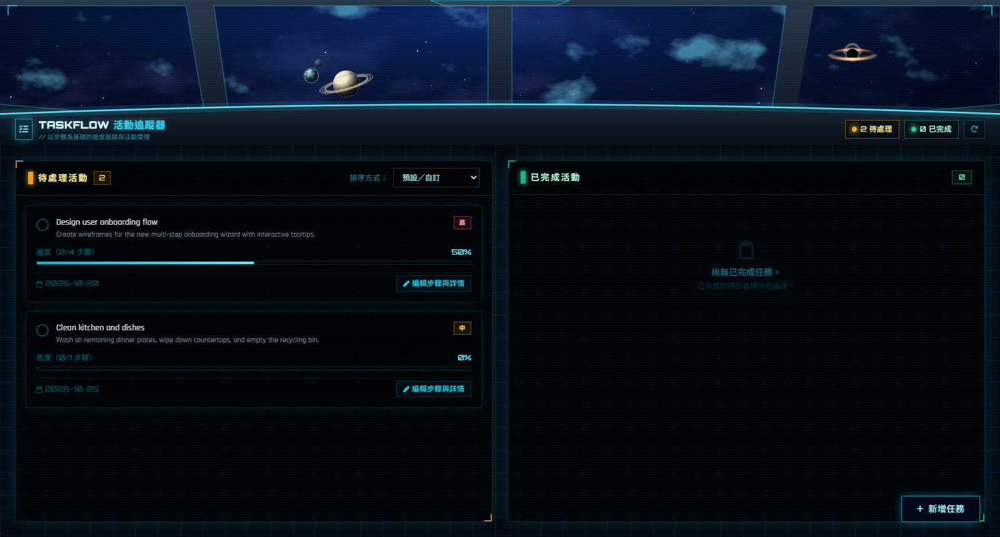

# TaskFlow 活動追蹤器

潛艇駕駛艙風格的個人任務追蹤器：上方是會飛過星星與行星的太空窗景，下方是待處理／已完成兩欄任務面板。

## 功能

- 新增任務，設定優先度（高／中／低）與日期
- 每個任務可拆成多個步驟，依完成步驟顯示進度條
- 待處理與已完成分欄顯示，可自訂排序
- 資料存在瀏覽器的 localStorage，重新整理不會消失
- 太空窗景動畫：星星朝你飛來、行星不斷出現（系統開啟「減少動態效果」時會自動停止）

## 使用方式

不需要安裝，直接用瀏覽器開啟 `activity_tracker.html` 即可（需要網路以載入 Tailwind、Font Awesome 與字型）。

右上角的 ↻ 按鈕可重置為範例資料。

## 檔案

| 檔案 | 說明 |
| --- | --- |
| `activity_tracker.html` | 主程式（單一 HTML 檔） |
| `favicon.svg` | 網站圖示 |
| `docs/screenshot.png` | README 截圖 |
